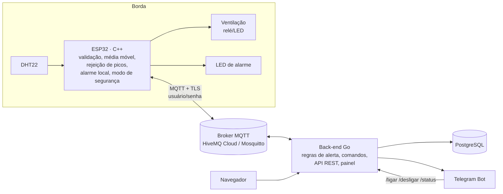

# Ambiente Monitorado

Monitoramento de temperatura e umidade com ESP32, MQTT, back-end em Go, PostgreSQL, painel web e alertas no Telegram.
Projeto final da disciplina *Arquitetura de Sistemas IoT e Computação em Nuvem*.



## Estrutura

| Pasta | Conteúdo |
|---|---|
| `cmd/server` | Servidor: MQTT → regras → PostgreSQL → API/painel → Telegram |
| `cmd/simulator` | ESP32 simulado em Go (mesmo protocolo do firmware) |
| `internal/alerts` | Motor de alertas (N leituras seguidas, lembretes, histerese) + testes |
| `internal/broker` | Cliente MQTT do back-end e definição dos tópicos |
| `internal/service` | Regras de negócio, watchdog de dispositivos, fila de notificações, comandos do Telegram |
| `internal/store` | PostgreSQL: migrações e consultas (inclui métricas de SLA) |
| `internal/api` | API REST e autenticação do painel |
| `web/static` | Painel web (HTML/JS puro, embutido no binário) |
| `firmware/esp32` | Firmware C++ (PlatformIO/Arduino) + circuito do Wokwi |
| `mosquitto` | Broker local com senha e ACL por dispositivo |

## Rodando localmente

Pré-requisitos: Docker (e Go 1.26 se quiser rodar fora do Docker).

```bash
cp .env.example .env        # troque as senhas
docker compose up -d --build
open http://localhost:8080
```

Para ter dados sem hardware, rode o simulador (digite `t 35` para esquentar, `h 80` para umidade):

```bash
go run ./cmd/simulator -pass <SIM_PASSWORD do .env> -t 24
```

Testes: `go test ./...` e, para a lógica de borda do firmware,
`c++ -std=c++17 -Ifirmware/esp32/src firmware/esp32/test/edge_test.cpp -o /tmp/edge && /tmp/edge`.

## Tópicos MQTT

| Tópico | Sentido | QoS | Conteúdo |
|---|---|---|---|
| `ambiente/<id>/telemetry` | ESP32 → nuvem | 0 | `{boot_id, seq, ts, temperature, humidity, raw_*, actuator, edge{alarm,failsafe,discarded}}` |
| `ambiente/<id>/status` | ESP32 → nuvem | 1, retido | `{online, fw, ip}`; o Last Will publica `{online:false}` |
| `ambiente/<id>/ack` | ESP32 → nuvem | 0 | `{id, actuator}` confirma o comando |
| `ambiente/<id>/cmd` | nuvem → ESP32 | 1 | `{id, action: "on"/"off"}` |
| `ambiente/<id>/config` | nuvem → ESP32 | 1, retido | `{temp_min, temp_max, hum_min, hum_max}` |

No Mosquitto local, cada dispositivo usa o próprio id como usuário e, pela ACL, só acessa os próprios tópicos.

## Telegram

1. No Telegram, fale com **@BotFather** → `/newbot` → copie o token.
2. Mande qualquer mensagem para o seu bot e descubra seu chat id com **@userinfobot**.
3. Preencha `TELEGRAM_BOT_TOKEN` e `TELEGRAM_CHAT_ID` no `.env` e rode `docker compose up -d`.

O bot envia os alertas e aceita `/status`, `/ligar`, `/desligar` e `/limites`, respondendo só ao chat configurado.

## Broker na nuvem (HiveMQ Cloud)

O plano gratuito *Serverless* do HiveMQ não aceita novos cadastros e será desligado em 31/12/2026.
Clusters já existentes continuam funcionando até lá; alternativa gratuita equivalente: EMQX Cloud Serverless.

1. No cluster, em *Access Management*, crie as credenciais `backend` e uma por dispositivo (ex.: `esp32-sala-01`),
   todas com permissão *Publish and Subscribe*.
2. No `.env`: `MQTT_URL=tls://<cluster>.s1.eu.hivemq.cloud:8883`, `MQTT_USERNAME=backend`, `MQTT_PASSWORD=...`.
3. No firmware (`secrets.h`): mesmo host, porta 8883, `MQTT_USE_TLS 1`.

## ESP32

**Montagem física:** DHT22 (dados no GPIO 4 com pull-up de 10 kΩ, VCC 3V3), módulo relé ou LED + 220 Ω no GPIO 18 (ventilação), LED + 220 Ω no GPIO 19 (alarme).

```bash
cd firmware/esp32
cp include/secrets.example.h include/secrets.h   # preencha Wi-Fi e broker
pio run -t upload && pio device monitor
```

**Wokwi (simulação):** no VS Code com a extensão Wokwi, rode `pio run` e abra `diagram.json`.
No navegador, gere um arquivo único com `./tools/bundle-wokwi.sh` (dentro de `firmware/esp32`; a saída em
`wokwi-bundle/` fica fora do git porque contém senhas). Em wokwi.com → novo projeto ESP32 (Arduino), cole o
`sketch.ino`, o `diagram.json` e crie a aba `libraries.txt`. O Wokwi no navegador só alcança brokers na internet.

## Processamento na borda (ESP32)

- Validação física das leituras (faixas do DHT22, NaN).
- Rejeição de picos: saltos > 5 °C / 15 % são descartados, a menos que se repitam 3 vezes (mudança real).
- Média móvel de 5 amostras (uma a cada 2 s).
- *Report by exception*: publica quando o valor muda ≥ 0,3 °C / 1 %, a cada 10 s como batimento, ou a cada 2 s em alarme.
- Alarme local (LED vermelho) com os limites recebidos da nuvem e salvos na flash.
- Modo de segurança: sem nuvem por 30 s e temperatura acima do limite → liga a ventilação sozinho e avisa ao reconectar.

## API

| Método | Rota | Descrição |
|---|---|---|
| GET | `/api/overview` | Dispositivos, última leitura, alertas ativos, estado do broker |
| GET | `/api/devices/{id}/readings?minutes=60` | Histórico |
| GET | `/api/devices/{id}/readings.csv` | Exportação CSV |
| GET/POST | `/api/devices/{id}/commands` | Lista / envia comando `{"action":"on"}` |
| PUT | `/api/devices/{id}/limits` | Altera limites (também enviados ao ESP32) |
| PUT | `/api/devices/{id}/name` | Renomeia o dispositivo |
| GET | `/api/alerts?device=` | Alertas e status do envio ao Telegram |
| GET | `/api/metrics?window=24h` | Indicadores de SLA (latências p50/p95, completude, sucesso de comandos) |
| GET | `/healthz` | Saúde (banco e broker), para monitoramento externo |
